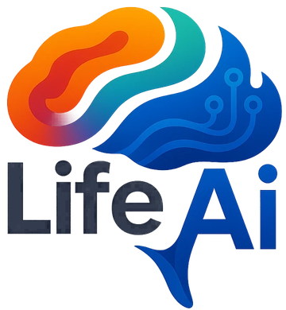

<picture><source media="(prefers-color-scheme: dark)" srcset="https://raw.githubusercontent.com/LifeAI-Dev/.github/main/assets/lifeai-dark.png"></picture>

# LifeAi

### Next-generation software.

AI-powered software products

   

&nbsp;&nbsp;

<b>English</b> · <a href="#lifeai-בעברית">עברית</a>

LifeAi is a technology company that builds AI-powered software products. We build fast, simple and precise tools that make complex, everyday tasks easy and accessible to everyone.

<table>
<tr>
<td align="center" width="25%"><h3>4</h3><b>Our own products</b> Three already available</td>
<td align="center" width="25%"><h3>400+</h3><b>Translation languages</b> In Snap Translate</td>
<td align="center" width="25%"><h3>&#126;100</h3><b>Speech languages</b> In Swift Speak</td>
<td align="center" width="25%"><h3>100%</h3><b>On-device processing</b> In every app</td>
</tr>
</table>

## Every product solves one real need.

<table>
<tr><td width="76" align="center"></td><td><a href="https://github.com/LifeAI-Dev/Swift-Speak"><b>Swift Speak</b></a> · You speak. Already written. Voice typing for Windows, even offline Windows 10 and 11 · Works offline too · Free for personal use</td><td width="24%"><a href="https://lifeai.ovh/en/swift-speak">Download from the website</a></td></tr>
<tr><td width="76" align="center"></td><td><a href="https://github.com/LifeAI-Dev/Snap-Translate"><b>Snap Translate</b></a> · Your whole screen. In your language. Screen translator for Windows Windows 11 · Works offline too · Free for personal use</td><td width="24%"><a href="https://lifeai.ovh/en/snap-translate">Download from the website</a></td></tr>
<tr><td width="76" align="center"></td><td><a href="https://github.com/LifeAI-Dev/SearchAble"><b>SearchAble</b></a> · Any file. One sentence away. Local AI file search for Windows Windows 10 and 11 · Works offline too · Free for personal use</td><td width="24%"><a href="https://lifeai.ovh/en/searchable">Download from the website</a></td></tr>
<tr><td width="76" align="center"></td><td><b>DriveLog</b> · Calendar updated. Hands on the wheel. Calendar and voice agent for driving instructors Manage by voice · Weekly and daily calendar · Student cards</td><td width="24%"><b>Coming soon</b> <a href="https://lifeai.ovh/en/drivelog">Website</a></td></tr>
</table>

## What our Windows apps share

<table>
<tr>
<td width="33%" valign="top"> <b>Everything runs on your PC</b> Speech recognition, translation and search happen on your own computer. No servers, no cloud.</td>
<td width="33%" valign="top"> <b>Works offline too</b> The internet is needed only for the first setup and to check for updates.</td>
<td width="33%" valign="top"> <b>Free for personal use</b> For commercial use, <a href="mailto:contact@lifeai.ovh">contact us</a> for a license.</td>
</tr>
</table>

## Contact

<a href="https://lifeai.ovh/en/">lifeai.ovh</a> · <a href="mailto:contact@lifeai.ovh">contact@lifeai.ovh</a> · <a href="https://lifeai.ovh/en/contact">Contact page</a>

Like what we build? <a href="https://ko-fi.com/lifeai">Support us on Ko-fi</a> ☕

---

## LifeAi בעברית

LifeAi היא חברת טכנולוגיה שמפתחת מוצרי תוכנה מבוססי בינה מלאכותית. אנחנו בונים כלים מהירים, פשוטים ומדויקים, שהופכים משימות מורכבות ויומיומיות לקלות ונגישות לכל אחד.

<table>
<tr>
<td align="center" width="25%"><h3>4</h3><b>מוצרים משלנו</b> שלושה כבר להורדה</td>
<td align="center" width="25%"><h3>400+</h3><b>שפות תרגום</b> ב-Snap Translate</td>
<td align="center" width="25%"><h3>כ-100</h3><b>שפות דיבור</b> ב-Swift Speak</td>
<td align="center" width="25%"><h3>100%</h3><b>עיבוד על המחשב</b> בכל התוכנות</td>
</tr>
</table>

### כל מוצר פותר צורך אמיתי אחד.

<table>
<tr><td width="76" align="center"></td><td><a href="https://github.com/LifeAI-Dev/Swift-Speak"><b>Swift Speak</b></a> · מדברים. וזה כבר כתוב. הקלדה קולית ל-Windows, גם בלי אינטרנט Windows 10 ו-11 · עובד גם בלי אינטרנט · חינם לשימוש אישי</td><td width="24%"><a href="https://lifeai.ovh/swift-speak">להורדה מהאתר</a></td></tr>
<tr><td width="76" align="center"></td><td><a href="https://github.com/LifeAI-Dev/Snap-Translate"><b>Snap Translate</b></a> · כל מה שעל המסך. בשפה שלך. תרגום מסך ומסמכים ל-Windows Windows 11 · עובד גם בלי אינטרנט · חינם לשימוש אישי</td><td width="24%"><a href="https://lifeai.ovh/snap-translate">להורדה מהאתר</a></td></tr>
<tr><td width="76" align="center"></td><td><a href="https://github.com/LifeAI-Dev/SearchAble"><b>SearchAble</b></a> · כל קובץ. במרחק משפט אחד. חיפוש קבצים במחשב לפי תוכן ומשמעות Windows 10 ו-11 · עובד גם בלי אינטרנט · חינם לשימוש אישי</td><td width="24%"><a href="https://lifeai.ovh/searchable">להורדה מהאתר</a></td></tr>
<tr><td width="76" align="center"></td><td><b>DriveLog</b> · היומן מתעדכן. הידיים על ההגה. יומן וסוכן קולי למורי נהיגה ניהול בקול · יומן שבועי ויומי · כרטיס תלמיד</td><td width="24%"><b>בקרוב</b> <a href="https://lifeai.ovh/drivelog">לאתר</a></td></tr>
</table>

### מה משותף לתוכנות שלנו ל-Windows

<table>
<tr>
<td width="33%" valign="top"> <b>הכול רץ על המחשב שלכם</b> זיהוי הדיבור, התרגום והחיפוש נעשים על המחשב שלכם. בלי שרתים ובלי ענן.</td>
<td width="33%" valign="top"> <b>עובד גם בלי אינטרנט</b> האינטרנט נדרש רק להתקנה הראשונה ולבדיקת עדכונים.</td>
<td width="33%" valign="top"> <b>חינם לשימוש אישי</b> לשימוש מסחרי, <a href="mailto:contact@lifeai.ovh">כתבו לנו</a> לקבלת רישיון.</td>
</tr>
</table>

### יצירת קשר

<a href="https://lifeai.ovh/">lifeai.ovh</a> · <a href="mailto:contact@lifeai.ovh">contact@lifeai.ovh</a> · <a href="https://lifeai.ovh/contact">עמוד יצירת הקשר</a>

אוהבים את מה שאנחנו בונים? <a href="https://ko-fi.com/lifeai">תמכו בנו ב-Ko-fi</a> ☕

 

 

<picture><source media="(prefers-color-scheme: dark)" srcset="https://raw.githubusercontent.com/LifeAI-Dev/.github/main/assets/lifeai-dark.png"></picture>

Made by <a href="https://lifeai.ovh/en/"><b>LifeAi</b></a> · AI-powered software products

